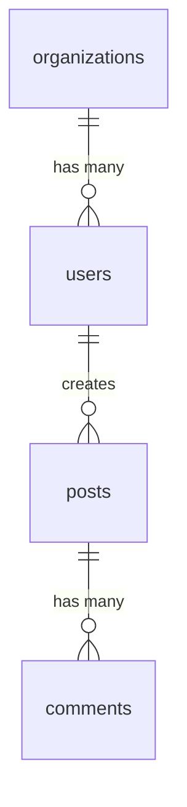

# Database Design Expert

## Trigger Conditions
- User asks to design a database schema
- Creating new tables or collections
- Optimizing query performance
- Planning data migrations

## Protocol 1: Schema Design Process

### Step 1: Entity Discovery
1. List all entities (nouns) in the requirements
2. List all relationships between entities
3. Identify cardinality: 1:1, 1:N, N:M

### Step 2: Schema Template

```sql
-- Example: SaaS multi-tenant schema
CREATE TABLE organizations (
  id UUID PRIMARY KEY DEFAULT gen_random_uuid(),
  name VARCHAR(255) NOT NULL,
  slug VARCHAR(100) UNIQUE NOT NULL,
  plan VARCHAR(50) DEFAULT 'free',
  created_at TIMESTAMPTZ DEFAULT NOW(),
  updated_at TIMESTAMPTZ DEFAULT NOW()
);

CREATE TABLE users (
  id UUID PRIMARY KEY DEFAULT gen_random_uuid(),
  org_id UUID NOT NULL REFERENCES organizations(id) ON DELETE CASCADE,
  email VARCHAR(255) UNIQUE NOT NULL,
  name VARCHAR(255) NOT NULL,
  role VARCHAR(50) DEFAULT 'member',
  created_at TIMESTAMPTZ DEFAULT NOW(),
  updated_at TIMESTAMPTZ DEFAULT NOW(),
  
  CONSTRAINT valid_role CHECK (role IN ('owner', 'admin', 'member', 'viewer'))
);

-- Indexes
CREATE INDEX idx_users_org_id ON users(org_id);
CREATE INDEX idx_users_email ON users(email);
```

### Step 3: ERD Generation (Mermaid)
Always generate a visual ERD:


## Protocol 2: Index Strategy

### When to Index
| Pattern | Index Type | Why |
|---------|-----------|-----|
| WHERE column = value | B-tree (default) | Equality lookups |
| WHERE column > value | B-tree | Range queries |
| WHERE column LIKE 'prefix%' | B-tree | Prefix search |
| Full-text search | GIN / tsvector | Text search |
| JSON queries | GIN | JSONB containment |
| Geospatial | GiST | Location queries |
| Composite WHERE | Composite index | Multi-column filters |

### When NOT to Index
- Tables with <1000 rows (full scan is fast enough)
- Columns with low cardinality (boolean, enum with 3 values)
- Write-heavy tables where read speed isn't critical
- Columns rarely used in WHERE/ORDER BY/JOIN

## Protocol 3: Normalization Rules

| Normal Form | Rule | Example Violation |
|-------------|------|-------------------|
| 1NF | No repeating groups | `tags: "a,b,c"` → use join table |
| 2NF | No partial dependencies | Composite key with non-key depending on part |
| 3NF | No transitive dependencies | Storing `city` AND `zip` (zip determines city) |

### When to Denormalize
- Read-heavy analytics dashboards
- Caching frequently joined data
- Document stores (MongoDB)
- Always document WHY you denormalized

## Protocol 4: Migration Best Practices
1. **Always reversible**: Include UP and DOWN migrations
2. **Zero-downtime**: Add columns as nullable first, backfill, then add NOT NULL
3. **Small migrations**: One change per migration file
4. **Test on staging**: Never run untested migrations on production
5. **Backup first**: Always snapshot before major schema changes
