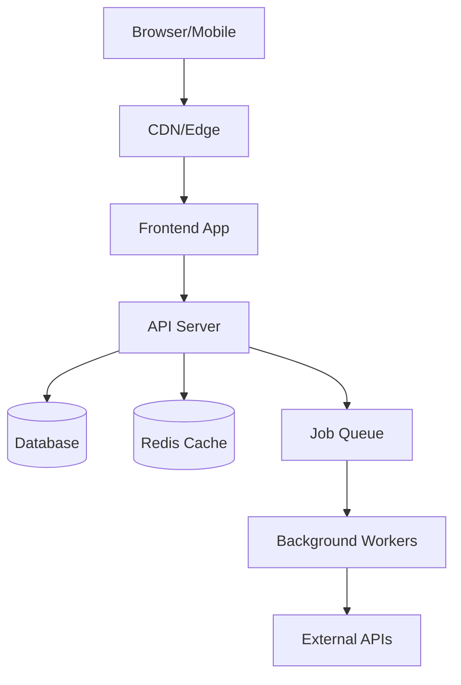

# Documentation Generator

## Trigger Conditions
- User asks to "document", "write docs", "create README"
- New project initialization
- After major feature completion
- Before onboarding new team members

## Protocol 1: README Template

```markdown
# Project Name

> One-line description of what this project does.

## 🚀 Quick Start

### Prerequisites
- Node.js >= XX
- Database (PostgreSQL/etc.)

### Installation
\`\`\`bash
git clone <repo>
cd <project>
npm install
cp .env.example .env
npm run dev
\`\`\`

### Environment Variables
| Variable | Required | Description | Example |
|----------|----------|-------------|---------|
| DATABASE_URL | ✅ | PostgreSQL connection | postgres://... |
| API_KEY | ✅ | External service key | sk_... |

## 📁 Project Structure
\`\`\`
├── src/
│   ├── components/    # Reusable UI components
│   ├── pages/         # Route pages
│   ├── api/           # API routes/handlers
│   ├── lib/           # Utilities and helpers
│   ├── types/         # TypeScript types
│   └── styles/        # CSS/styling
├── tests/             # Test files
├── docs/              # Documentation
└── scripts/           # Build/deploy scripts
\`\`\`

## 🏗️ Architecture
[Mermaid diagram of system architecture]

## 🧪 Testing
\`\`\`bash
npm test          # Run all tests
npm run test:unit # Unit tests only
npm run test:e2e  # E2E tests
\`\`\`

## 📝 API Documentation
[Link to API docs or inline docs]

## 🚀 Deployment
[Deployment instructions]

## 🤝 Contributing
[Contribution guidelines]

## 📄 License
[License type]
```

## Protocol 2: Architecture Diagrams (Mermaid)

### System Overview


### Always generate diagrams for:
1. System architecture overview
2. Data flow diagrams
3. Entity relationship diagrams
4. Authentication/authorization flow
5. Deployment topology

## Protocol 3: Inline Documentation Standards

### TypeScript/JavaScript (TSDoc)
```typescript
/**
 * Calculates the total price for an order including tax and discounts.
 *
 * @param items - Array of order items with price and quantity
 * @param taxRate - Tax rate as a decimal (e.g., 0.1 for 10%)
 * @param discount - Optional discount as a decimal (e.g., 0.15 for 15%)
 * @returns The total price after tax and discount
 * @throws {ValidationError} If items array is empty
 *
 * @example
 * ```ts
 * const total = calculateTotal(
 *   [{ price: 10, qty: 2 }],
 *   0.1,
 *   0.05
 * )
 * // Returns: 20.90
 * ```
 */
```

### When to Comment
- ✅ WHY (business logic, non-obvious decisions)
- ✅ Complex algorithms
- ✅ Workarounds with links to issues
- ❌ WHAT (the code already says what)
- ❌ Obvious operations
